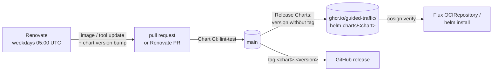

# helm-charts

[](https://github.com/guided-traffic/helm-charts/actions)
[](LICENSE)

Helm charts of guided-traffic, one directory per chart, released as signed OCI
artifacts to `oci://ghcr.io/guided-traffic/helm-charts/<chart>`. CI lints,
unit-tests and schema-validates every chart on every pull request; a chart
whose version has no release yet is packaged, pushed, signed with cosign
(keyless), attested and tagged when it reaches `main`. Renovate keeps the
images in the charts and the CI tooling current and bumps the chart version
with them.



## ✨ Key Features

- 📦 **Chart per directory** — `charts/<chart>/` is discovered automatically by CI, release and Renovate.
- 🏷️ **Version-driven releases** — the `version` in `Chart.yaml` is the trigger; a version without git tag is released, a released one is never overwritten.
- 🧪 **Tested on every PR** — repository conventions, `helm lint --strict`, helm-unittest suites, kubeconform against Kubernetes 1.34 and 1.37 for every values set in `ci/`.
- 🔢 **Version bump enforced** — a PR that changes a packaged file without a higher chart version fails.
- ✍️ **Signed and attested** — cosign keyless signature and SLSA build provenance on every chart digest.
- 🤖 **Renovate** — image tags and digests in `values.yaml`, pinned tools in the `Makefile`, GitHub Actions; image updates bump the chart version.
- 📌 **One pinned toolchain** — helm, kubeconform and helm-unittest are pinned once in the `Makefile`; CI and local runs use the same binaries.
- 🛡️ **Strict values** — every chart ships a `values.schema.json` that rejects unknown keys.

## 📛 Naming conventions

| What | Pattern | Example |
|---|---|---|
| Chart directory | `charts/<chart>/` (equals `name` in `Chart.yaml`) | `charts/galaxy-ng/` |
| OCI artifact | `oci://ghcr.io/guided-traffic/helm-charts/<chart>:<version>` | `oci://ghcr.io/guided-traffic/helm-charts/galaxy-ng:2.0.0` |
| ghcr.io package | `helm-charts/<chart>` in the guided-traffic organisation | `helm-charts/galaxy-ng` |
| Git tag and GitHub release | `<chart>-<version>` | `galaxy-ng-2.0.0` |
| Release asset | `<chart>-<version>.tgz` | `galaxy-ng-2.0.0.tgz` |
| Signing identity (certificate SAN) | `https://github.com/guided-traffic/helm-charts/.github/workflows/release.yml@refs/heads/main` | — |
| Signing issuer | `https://token.actions.githubusercontent.com` | — |
| Image values | `<component>.image.repository` + `<component>.image.tag` | `api.image.tag: "71e98059"` |
| Extra values sets for CI | `charts/<chart>/ci/<name>-values.yaml` | `ci/full-values.yaml` |
| Unit test suites | `charts/<chart>/tests/<name>_test.yaml` | `tests/settings_test.yaml` |
| Renovate branches | `renovate/<chart>-<dependency or group>`, `renovate/chart-tooling`, `renovate/<action>` | `renovate/galaxy-ng-galaxy-ng-images` |
| Pinned tools | `.tools/<tool>-<version>/<binary>` | `.tools/helm-v4.3.1/helm` |
| Packages | `.dist/<chart>-<version>.tgz` | `.dist/galaxy-ng-2.0.0.tgz` |

## 📚 Documentation

| Document | Content |
|---|---|
| [docs/developer/](docs/developer/README.md) | Layout, tests, release, Renovate, adding a chart, conventions |
| [docs/security/](docs/security/README.md) | Trust boundaries and token permissions, artifact integrity |
| [SECURITY.md](SECURITY.md) | Reporting a vulnerability |
| [charts/galaxy-ng/README.md](charts/galaxy-ng/README.md) | galaxy-ng values reference and 1.x upgrade |
| [Helm OCI registries](https://helm.sh/docs/topics/registries/) | `helm install oci://…` |
| [Flux OCIRepository](https://fluxcd.io/flux/components/source/ocirepositories/) | `verify`, `layerSelector` |
| [cosign verify](https://docs.sigstore.dev/cosign/verifying/verify/) | keyless verification |

## 🚀 TL;DR

**Install a chart**

```bash
helm install galaxy-ng oci://ghcr.io/guided-traffic/helm-charts/galaxy-ng \
  --version 2.0.0 --namespace galaxy --values my-values.yaml   # example
```

**Verify the signature first**

```bash
cosign verify ghcr.io/guided-traffic/helm-charts/galaxy-ng:2.0.0 \
  --certificate-identity https://github.com/guided-traffic/helm-charts/.github/workflows/release.yml@refs/heads/main \
  --certificate-oidc-issuer https://token.actions.githubusercontent.com
```

**Consume with Flux, signature checked on every pull**

```yaml
apiVersion: source.toolkit.fluxcd.io/v1
kind: OCIRepository
metadata:
  name: galaxy-ng
  namespace: flux-system
spec:
  interval: 1h
  url: oci://ghcr.io/guided-traffic/helm-charts/galaxy-ng
  ref:
    tag: "2.0.0"  # example
  layerSelector:
    mediaType: application/vnd.cncf.helm.chart.content.v1.tar+gzip
    operation: copy
  verify:
    provider: cosign
    matchOIDCIdentity:
      - issuer: ^https://token\.actions\.githubusercontent\.com$
        subject: ^https://github\.com/guided-traffic/helm-charts/\.github/workflows/release\.yml@refs/heads/main$
```

Reference it from a HelmRelease with `chartRef: {kind: OCIRepository, name: galaxy-ng, namespace: flux-system}`.

**Change a chart**

```bash
make test                      # lint + unit tests + kubeconform, all charts
make check-version             # changed charts carry a new version (vs origin/main)
```

<details>
<summary>Upgrade and uninstall</summary>

```bash
helm upgrade galaxy-ng oci://ghcr.io/guided-traffic/helm-charts/galaxy-ng \
  --version <new-version> --namespace galaxy --values my-values.yaml
helm uninstall galaxy-ng --namespace galaxy
```

Read the chart's README before a major version: it lists the values that
changed. `helm uninstall` deletes chart-owned PVCs unless they carry
`helm.sh/resource-policy: keep`.
</details>

## 📖 Full reference

### Charts

| Chart | Version | Description |
|---|---|---|
| [galaxy-ng](charts/galaxy-ng/README.md) | 2.0.0 | Galaxy NG (Ansible collection server) with external PostgreSQL and optional Redis/Valkey |

### Make targets

| Target | What it does |
|---|---|
| `make tools` | Downloads the pinned helm, kubeconform, helm-unittest into `.tools/`, checksum-verified |
| `make lint` | Repository conventions (`scripts/chart.sh lint`) and `helm lint --strict` with the default values and every `ci/*-values.yaml` |
| `make unittest` | helm-unittest suites in `charts/<chart>/tests/` |
| `make kubeconform` | `helm template` per Kubernetes version and values set, validated with `kubeconform -strict` |
| `make test` | `lint` + `unittest` + `kubeconform` |
| `make check-version` | Fails if a chart's packaged files changed against `BASE_REF` without a higher, unreleased version |
| `make package` | `helm package` into `.dist/` |
| `make list` | Charts the targets act on |

| Variable | Default | Meaning |
|---|---|---|
| `CHARTS` | every `charts/*/Chart.yaml` | Narrow the run: `make test CHARTS=galaxy-ng` |
| `BASE_REF` | `origin/main` | Reference for `check-version` |
| `HELM_VERSION` | `v4.3.1` | Pinned, updated by Renovate |
| `KUBECONFORM_VERSION` | `v0.8.0` | Pinned, updated by Renovate |
| `HELM_UNITTEST_VERSION` | `v1.2.1` | Pinned, updated by Renovate |
| `KUBERNETES_VERSIONS` | `1.34.0 1.37.0` | Schema versions for kubeconform; maintained by hand |

### Chart contract

What [`scripts/chart.sh`](scripts/chart.sh) enforces for every chart (`lint`, `unittest`):

| Rule | Why |
|---|---|
| `apiVersion: v2`, `name` equals the directory | discovery and OCI path derive from the directory |
| `version` is SemVer | release trigger and tag `<chart>-<version>` |
| first `sources` entry is `https://github.com/guided-traffic/helm-charts` | becomes `org.opencontainers.image.source`; links the ghcr.io package to this repository |
| `README.md` and `values.schema.json` exist | values reference; unknown keys rejected |
| at least one `tests/*_test.yaml` | `make unittest` fails without |

### Workflows

| Workflow | Trigger | Permissions | Secrets |
|---|---|---|---|
| [Chart CI](.github/workflows/ci.yml) (`lint-test`) | pull request, push to `main`, manual | `contents: read` | none |
| [Release Charts](.github/workflows/release.yml) | push to `main` touching `charts/`, `Makefile`, `scripts/` or the workflow; manual | release job: `contents: write`, `packages: write`, `id-token: write`, `attestations: write` | `GITHUB_TOKEN` |
| [Renovate Dependencies](.github/workflows/renovate.yml) | weekdays 05:00 UTC, push to `main`, manual | `contents: read` (Renovate acts with the App token) | `APP_CLIENT_ID`, `APP_PRIVATE_KEY` (organisation) |

> **Security:** the release job is the only place that can publish. Its
> permissions are scoped to the job, it runs only on `main`, and the signing
> identity names exactly this workflow on `main` — a signature from any other
> workflow or branch does not match the verification above. Details:
> [docs/security/](docs/security/README.md).

## 🛠 Development

```bash
make tools          # once; again after a pin changed
make test           # what CI runs
make check-version  # what CI runs on pull requests
```

The full guide — layout, test tiers, release, Renovate, adding a chart — is
in [docs/developer/](docs/developer/README.md).

## License

[Apache License 2.0](LICENSE)
